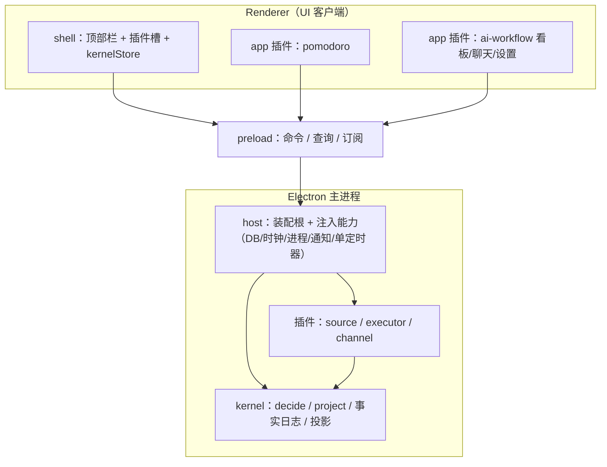
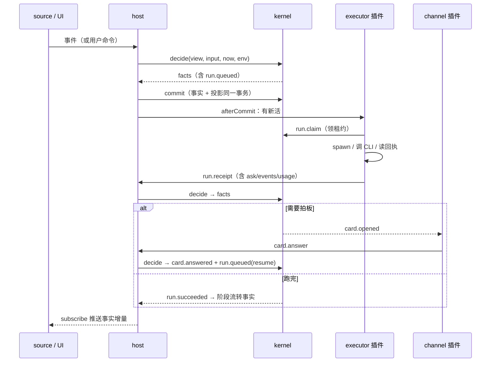

# 架构：内核 + 插件（Workbench v2）

> 2026-11-04 设计稿。本文取代 `SPEC-ai-workflow.md` 中「目录与分层」部分；该文的阶段语义、终态归一、取消时序等**行为**仍是迁移基线，直到对应里程碑完成。
> 来源：卡兹克《开源我这折腾了 1 年的「Agent 自动化系统」》与其实现在 [`agent-autoloop`](https://github.com/KKKKhazix/agent-autoloop)。借的是结构，不是代码。

## 一句话

内核只做四件事：**收事件、按规则分活、派活、记账**。事件来源、执行器、审批通道、界面全部是插件。内核不知道任何产品的名字，也不主动连任何东西。

## 为什么这么切

现状三个病根，都是「没有单一真相源」的变体：

| 现状                                                    | 证据                                                                      | 内核 + 插件怎么解                           |
| ------------------------------------------------------- | ------------------------------------------------------------------------- | ------------------------------------------- |
| 同一规则多处实现：执行中 = DB 现算 + 内存计数 + UI 再算 | `repository.ts:583`、`runner.ts:41`、`KanbanBoard.tsx:30`                 | 运行生命周期只有内核一张投影，UI 与插件只读 |
| 崩溃后 run 永久卡 `running`，任务锁死                   | `runner.ts:54`、`engine.ts:101`                                           | 内核持有租约 + 启动对账，超时自动回收       |
| 账本只有协议帧，没有决策                                | `schema.ts:92` 无 actor/cause 字段                                        | 事实日志记录「谁、为什么、依据哪版规则」    |
| 新增一个运行时改 4 处                                   | `ai-workflow-api.ts:15`、`schema.ts:13`、`registry.ts:36`、`detect.ts:22` | 运行时协议 = 插件，manifest 一处声明        |
| 迁移手写、DDL 双源                                      | `migrate.ts:32`、`schema.ts:133`                                          | 只升级投影格式，数据从事实日志重建          |

## 分层



依赖方向（谁可以 import 谁；ESLint 强制）：

```
kernel   ──▶ protocol（仅类型）；不 import electron / node:fs / node:child_process / 网络
sdk      ──▶ protocol（仅类型）
plugins  ──▶ sdk + protocol；不 import host 内部实现，不 import 其它插件
host     ──▶ kernel + protocol + sdk + 插件注册表；不 import renderer
renderer ──▶ shared 类型 + preload 桥接；不 import electron / Node 内置
```

插件唯一的跨插件复用例外：`src/plugins/shared/` 只放纯函数（协议帧解析、参数转 argv）。

## 内核

### 四件事

| 动作   | 定义                                                                                  | 不做什么                                                       |
| ------ | ------------------------------------------------------------------------------------- | -------------------------------------------------------------- |
| 收事件 | 把外部触发（定时、文件、Webhook、app 事件、用户动作）规范化成 `event.received`        | 不抓取、不轮询、不发请求                                       |
| 分活   | 按规则或阶段决定交给哪个**智能体**；它的运行时决定在哪跑、什么权限、并发多少          | 不认识 dsh/claude 等产品名，只透传运行时配置里的 `executorKey` |
| 派活   | 生成 `run.queued`（指向智能体及其运行时），按该运行时的并发窗口发放租约 `run.claimed` | 不 spawn 进程、不知道进程长什么样                              |
| 记账   | 追加事实、更新投影、给出 `why` 时间线                                                 | 不做 UI、不做通知、不做迁移脚本                                |

### 任务的两个来源（同一套工作流引擎）

| 来源       | 例子                               | 内核产出                                          |
| ---------- | ---------------------------------- | ------------------------------------------------- |
| 规则建任务 | GitHub Issue、告警、定时、app 事件 | 规则命中 → `task.created`：进指定工作流与起始阶段 |
| 人工建任务 | 你自己新建任务 A                   | 选工作流 + 起始阶段                               |

**规则不直接派活。** 不管任务从哪来，进入阶段后都走同一条链：

```
任务 → 阶段（entry_mode = agent / user / none）
     → agent：该阶段绑定的智能体 → 它的运行时 → 执行器插件
     → user：停下等你
     → none：停在列里等你拖
```

所以「外部 Issue 进研发工作流」就是一条规则：`when: {source:'github', types:['issues.opened']}` → `to: {workflowId:'研发', stageId:'待办'}`。任务建好后与手工任务完全一样。

```
Issue #42 ──规则──▶ 任务「#42 登录页报错」· 研发工作流 · 待办
  ──进入──▶ 进行中（dev 智能体，edit）
  ──回执成功──▶ 审核中（review 智能体 read，或 user 等你）
  ──通过──▶ 测试中（qa 智能体）──▶ 已完成
```

- 研发与测试是**同一条工作流的阶段**时，零额外配置。
- 想拆成两个独立工作流，需要「跨工作流交接」：阶段完成时在目标工作流建一个关联任务。列为 M7 可选扩展，v1 建议先用一条工作流、用阶段区分角色。
- 拿不准或一次性的事：落「待办」或 `user` 阶段，不强行自动化。
- 系统可以给**建议**（按 label/关键词/同类任务上次去了哪），但只填表单，不代替你确认，也不进入内核决策。

### 分活不是模型判断

「按规则分活」是**确定性匹配**，不经过任何 Agent：

- 人写规则（唯一的决策时刻）：`when`（来源+类型，或 cron）→ 建到哪个工作流/阶段。
- 内核按 `source` 相等、`types` 精确 / `*` / `x.*` 命中，定时规则由 `clock.tick` 到点触发；多条命中就全部建任务，不排序、不取「最优」。
- 派给谁只由阶段 `entry_mode` 与绑定的智能体决定；事件里带 `cwd/agent/access` 直接拒收。`why` 可查用了哪版规则。
- 需要语义分类时，加一个**分类执行器**产出新事件类型（如 `issue.bug`），再由规则建任务——规则始终是唯一入口，分类结果也是可追溯、可重放的事实。

Agent 没有选择权：只能在回执里 `ask`（拍板）、`events`（再触发事件）、`later`（复查），这些回到内核后仍由规则建任务、阶段决定去向。

### Thread（线程）

- 同一入口（Issue、邮件线程、工单、外部会话）的事件按 `(source, externalRef)` 归入一个线程；线程是内核的**状态实体**（投影 `threads`），不是插件。
- 新事件默认追加到线程里**未完成的任务**（`reuse-task`：在当前阶段再跑一轮）；也可配成总是新建任务（`new-task`）。
- 上下文共享是**派生**的：宿主每轮从事实算出「线程上下文」（任务清单、**最近一轮产出**（独立 2000 字预算）、最近 3 条运行摘要、未决卡片、最近 10 条线程笔记、资料清单），简报 ≤6000 字，写进提示词并标注为资料而非指令。
- 线程默认**串行**（同一线程同时只有一个运行），派生任务排队；跨线程并行。
- 会话按 `(thread, agent)` 续接：同一线程内跨任务也能接上；首轮不续接。
- 手工任务也自动建隐式线程（`source='manual'`），之后可绑定 Issue/邮件入口；一个任务可派生多个子任务，默认继承同一线程，看板显示父子关系。

### 四个机制

| 机制         | 在本项目的含义                                                                 | 落点                                                                  |
| ------------ | ------------------------------------------------------------------------------ | --------------------------------------------------------------------- |
| 挂起零消耗   | Agent 要拍板时本轮结束、进程退出、run 进 `waiting`；回答后按会话续接重开一轮   | `run.waiting`、`card.answered` → `run.queued`（带 `resumeSessionId`） |
| 事件溯源     | 唯一权威是只追加的 `facts`；投影可随时重建；`why` 能还原「为什么跑这一轮」     | `facts` 表 + `project(fact)` + `projection_meta.format`               |
| 指令数据分离 | 别人写的文字只作为资料文件路径进入提示词；交给谁/在哪/什么权限只由本机规则决定 | 事件校验白名单 + `artifacts/<eventId>.md` + 提示词模板                |
| 跳数熔断     | Agent 回执里再触发的事件继承 `hops+1`，超过 8 层只记账不派活并开卡片           | `event.received.hops`、`event.dropped`                                |

### 确定性边界

`decide(view, input, now, env)` 是纯函数：不读时钟、不取随机数、不读文件、不发请求、不写库。时间、ID、规则版本、主密钥全部由宿主在边界传入。同样的 `(view, input, now, env)` 必得同样的 `facts`。

## 插件

四类，目录与 manifest 统一：

| 类型       | 负责                                                     | 内置                                                                                                                                  | 关键接口                                            |
| ---------- | -------------------------------------------------------- | ------------------------------------------------------------------------------------------------------------------------------------- | --------------------------------------------------- |
| `source`   | 把世界变成事件                                           | manual（UI 手动）、app 事件、Webhook、文件变化                                                                                        | `start(ctx) → stop`                                 |
| `executor` | 怎么调起并读回一轮（协议适配，无状态；**不是派活目标**） | `dsh`（DeepSeek Harness stdio）、`claude`（Claude Code stream-json）、`hermes`（ACP over stdio）、`command`（通用 CLI）；`codex` 后续 | `probe / models / detect(ctx) / run(ctx, turn, io)` |
| `channel`  | 把卡片送到人面前并接回答案                               | 应用内卡片（默认）、桌面通知、Webhook（飞书等，M7 后）                                                                                | `start(ctx)` + `onCard`                             |
| `app`      | 界面插件                                                 | `pomodoro`、`ai-workflow`                                                                                                             | `AppPlugin`（见 `SPEC-plugins.md`）                 |

- 交付流水线**不是新插件类型**：它是「自动化规则 + 智能体 + 项目配置」的组合（照抄 autoloop 结论）。
- **定时（cron）不是 source 插件**：规则里的 cron 由内核 `clock.tick` 派生事实，解析与下一次触发时刻都在纯内核里。
- 插件之间禁止互相 import；副作用只能经 `sdk` 暴露的能力（M3：日志、毫秒时钟、路径、配置、受 `capabilities` 约束的 process）并受 `capabilities` 约束。
- **注册表是唯一静态注册点**：`src/plugins/registry.ts` 导出 `executors: ReadonlyArray<{ key, label, manifest, plugin }>`，数组顺序即 UI 下拉与 detect 输出顺序。`main` 是唯一 import 它的装配根；`host/executor-registry.ts` 只按 `runtime.executorKey` 从注入的清单里取端口，未知 key 返回 `null`，由调度器落 `runtime_missing` 兜底终态——宿主不 import 任何具体插件实现。
- 内置插件编译期注册；第三方插件从 `userData/plugins/<kind>/<id>/` 加载，v1 不开放执行，M7 后以**子进程 + stdio JSONL** 接入。

### 对象分层（什么算插件）

| 层     | 是什么                     | 例子                                                                           | 改它要写代码吗 |
| ------ | -------------------------- | ------------------------------------------------------------------------------ | -------------- |
| 代码层 | 内核、宿主、插件           | `kernel`（含阶段流转）、`host`、`plugins/executors/dsh`、app 插件（看板/聊天） | 是             |
| 配置层 | 你创建、事实记录的领域数据 | **智能体**、**运行时**、工作流/阶段、规则                                      | 否，设置里改   |
| 状态层 | 系统产生的运行数据         | 任务、run、卡片、消息                                                          | 否，自动产生   |

**智能体与运行时属于配置层，不是插件**：它们由内核建模（投影 + 引用校验）、UI 编辑、事实记录，但没有自己的行为代码。运行时里的 `executorKey` 指向代码层的执行器插件——只有执行器才是插件。

**看板属于代码层的 app 插件，任务流转规则属于内核。** 看板只做三件事：读 `tasks.byWorkflow` 视图、发 `task.move`/`task.complete` 命令、渲染拖拽；「能不能拖」「算不算执行中」「失败退回哪」全部由内核决定，组件里不写。

## 宿主与客户端

- **host**：开库、迁移/重建、装配插件、对账租约、单定时器、spawn 子进程、发通知、托住窗口与托盘。它是唯一有副作用的层。
- **IPC**：收窄成三个动词——`dispatch(命令)`、`query(视图)`、`subscribe(事实增量)`；不再是一张 30 余方法的 RPC 表。
- **renderer**：`kernelStore` 持有快照 + 按 `seq` 应用增量；app 插件只声明视图与组件，不再自己算「执行中」。
- **聊天与运行帧**：执行器的帧实时走旁路给 UI 显示，同时**按批写 `run.frames` 事实**，重建后事件流完整；一轮结束写终态事实与 `message.appended`。逐帧单独入账才是不做的（日志膨胀），不是「不入账」。

## 一次运行的完整链路



## 数据

- 单一 `workbench.db`：`facts`（只追加）+ 投影表（`tasks`/`task_comments`/`runs`/`run_events`/`cards`/`workflows`/`stages`/`agents`/`runtimes`/`threads`/`conversations`/`messages`/`rules`/`plugin_config`/`projection_meta`）。
- `project(fact) → Change[]` 是纯函数；实时写入与重建走**同一条**投影路径。
- 启动时 `projection_meta.format` 不匹配或 `seq` 落后 → 同一事务内从 `facts` 重建；不再手写 12-step 迁移。
- v2 存量数据在 M1 按表分批写成 `snapshot.imported` 事实（无 `cause` 的导入根，`timeline` 标明「迁移导入」，不伪造因果）；此后日志即唯一权威。
- `run_events` 由 `run.frames` 批量事实派生，可重建；聊天帧同规则。
- 组织：`src/kernel/`（纯）· `src/protocol/`（校验）· `src/sdk/`（插件能力类型）· `src/host/`（装配）· `src/plugins/`（四类）· `src/renderer/src/{shell,apps}`。

## 关键决策

| 决策         | 选择                                                                  | 代价 / 不选的理由                                                                                                   |
| ------------ | --------------------------------------------------------------------- | ------------------------------------------------------------------------------------------------------------------- |
| 内核形态     | 主进程内的纯 TS 模块，不是独立服务                                    | 单机自用；进程内 IPC 直推更简单。保留 `decide` 纯函数，未来可原样搬进独立进程                                       |
| 派活单位     | 规则与阶段都指向**智能体**；运行时、执行器由智能体的 `runtimeId` 推导 | 执行器只是协议适配，避免「事件直接调 CLI」绕过智能体配置（系统提示词、权限、并发）                                  |
| 外部事件落点 | 规则只**建任务**（指定工作流与起始阶段），不直接建 run                | 外部事件与手工任务共用一套工作流引擎，避免两条并行派活路径                                                          |
| 上下文共享   | 线程 + **派生式**上下文（每轮从事实现算），不维护可变共享文件         | 可重建、可审计、可截断；可变 blob 会漂移且能藏注入                                                                  |
| 事实存什么   | 语义事实 + 计算式投影                                                 | 事实可读、可审；重建是 O(事实数) fold。autoloop 存 changes 换 O(1) 重建，我们规模小，选可读性                       |
| 规则来源     | DB 事实（UI 编辑），`rules.json` 只做导入导出                         | 避免文件与 DB 双源头（现状病根之一）；autoloop 的文件热加载不照抄                                                   |
| 插件隔离     | v1 进程内；第三方 v2 子进程                                           | 自用场景先保类型安全与开发效率；子进程留给不可信插件                                                                |
| 客户端       | renderer 是纯客户端，不持有业务权威状态                               | 业务真相（任务/运行/卡片）只在事实日志；计时器、表单草稿这类交互态可以留在 app 本地，跨会话或需要追溯的状态才入内核 |
| 聊天         | 与阶段执行共用 run 生命周期，`purpose='chat'`                         | 去掉 runner/chat 两条重复执行路径；看板仍不显示聊天 run                                                             |

不照抄的 5 条：无界面（产品本体就是 UI）、HTTP 长轮询 + 系统服务（改为 Electron 生命周期 + IPC 直推）、零运行时依赖（内核模块保留，整体不承诺）、`rules.json` 热加载（改 DB 事实）、插件即独立进程（v1 进程内）。

## 边界守则（可检查）

1. `src/kernel/**` 不得出现 `electron`、`node:fs`、`node:child_process`、`fetch`、`node:http`、`Date.now()`、`Math.random()`、`randomUUID()`。
2. `src/renderer/**` 不得 import `electron` / Node 内置（沿用现有 ESLint 规则）。
3. 只有 `host` 能写库、能 spawn、能发通知；`kernel` 只接收 `view`、只返回 `facts`。
4. 插件不得 import `src/host/**` 内部实现、不得 import 其它插件、不得直连数据库；副作用只经 `sdk` 且必须声明 `capabilities`；跨插件纯函数只放 `src/plugins/shared/`。宿主不得 import 具体插件实现，只接收装配根注入的注册表清单。
5. `viewSpec(input)` 必须声明投影切片，禁止全表装载；性能预算按「装载 + 决策」一起算。
6. 事件里的文字只能进资料文件与 `summary` 字段；`cwd/executor/access` 出现在事件里直接拒收；提示词不进命令行拼接。
7. 阶段语义（`SPEC-ai-workflow.md` 的 15 条硬约束）一条不改；阶段 id 稳定、删除用 tombstone。
8. 单实例锁 + WAL + `integrity_check` + 事实导出，M0 起就必须有。

## 评审已冻结的契约细节（2026-11-04）

初稿经独立评审后修掉的 7 个缺口，实施时按这些口径写：

| 缺口                          | 口径                                                                                                                            |
| ----------------------------- | ------------------------------------------------------------------------------------------------------------------------------- |
| 迟到的旧 attempt 回执覆盖终态 | 领取发 `leaseId = runId:attempt`；回执必须匹配 `leaseId + turn`，否则丢弃；宿主以 `actor.host` 兜底写 `timeout`/`executor_lost` |
| `waiting` 仍占租约与并发位    | 进 `waiting` 即释放，回答后重新领取；卡片默认不超时                                                                             |
| 运行帧不入账，重建丢事件流    | 帧按批写 `run.frames` 事实（单批 ≤500），`run_events` 可重建；实时旁路只是显示                                                  |
| 投影表清单三处不一致          | 以「数据」一节为准；`rules`/`plugin_config` 都从事实派生                                                                        |
| cron 归属三处矛盾             | cron 是内核规则，解析与时区墙钟在 `kernel/cron.ts`；夏令时跳过不补、重复只触发一次                                              |
| 执行器没有合法 spawn 途径     | 副作用统一走 `src/sdk`，按 `capabilities` 授权；跨插件复用只放 `plugins/shared/` 纯函数                                         |
| 单实例/WAL/导出缺失           | M0 起强制：单实例锁、WAL、`integrity_check`、事实导出                                                                           |

## 验收与度量

| 项       | 目标                                                                                                                                           |
| -------- | ---------------------------------------------------------------------------------------------------------------------------------------------- |
| 内核规模 | `src/kernel/` ≤ 2000 行（含注释），零第三方依赖                                                                                                |
| 决策性能 | 「装载 + `decide`」p99 < 8 ms（10 万事实、1 万任务规模），按 `viewSpec` 切片计量                                                               |
| 可靠性   | 单实例锁 + WAL；强杀重启后投影与事实一致，无残留 `running`                                                                                     |
| 重建     | 10 万事实 < 5 s；启动增量 < 100 ms                                                                                                             |
| 可追溯   | 任一 run 能用一条查询还原触发事件、规则版本、智能体、运行时、回执与流转                                                                        |
| 质量门   | `pnpm check` 全绿；覆盖率不降；阶段状态机分支 100%                                                                                             |
| 插件独立 | 新增一个运行时协议：只加执行器插件 + registry 一行，`runtimes.executors()` 与 detect 自动纳入，配置里选它即可；kernel / host / renderer 零改动 |

## 术语

- **事实（Fact）**：不可变的历史记录，唯一权威。
- **投影（Projection）**：从事实算出的可查询表，可丢可重建。
- **视图（View）**：内核决策时读到的投影切片。
- **智能体（Agent）**：派活目标，绑定运行时与能力（System Prompt）。
- **运行时（Runtime）**：执行环境实例（执行器插件、命令、权限模式、模型、并发上限）。
- **执行器（Executor）**：协议适配插件，只负责调起并读回一轮，不参与派活决策。
- **运行（Run）**：一次执行单元，`purpose` = `stage`（工作流阶段）或 `chat`（对话轮次）。
- **卡片（Card）**：一次待拍板事项；`open → answered/resolved`。
- **线程（Thread）**：同一入口的事件与任务共享的上下文容器，按 `(source, externalRef)` 归档。
- **租约（Lease）**：宿主调度器代运行时领取运行后的持有凭证，超时由内核回收。
- **跳数（Hops）**：事件被 Agent 再次派生的层数，上限 8。
